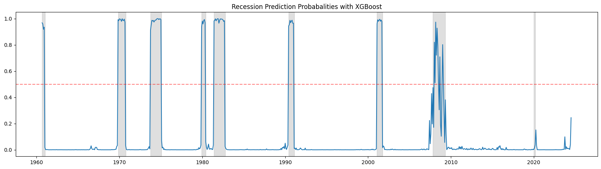

# Recession_Forecast

Forecasting next month's US recession regime (NBER) from 129 FRED-MD macroeconomic series with regularized logistic regression and XGBoost.

## Leak-free evaluation (update)

The original notebooks fit the stationarity tests, the scaler and the L1 feature selection on the **whole 1959–2024 sample** before splitting into training (1960–2001) and validation (2002–2024). Feature selection uses the labels, so it could see the validation recessions. This update rebuilds the evaluation so nothing is learned from data after the forecast date, and measures how much the leakage mattered.

**What changed** (`recession/`, `run_evaluation.py`):
- Stationarity (ADF) decisions use the training window only.
- Scaling and L1 feature selection are steps inside a scikit-learn `Pipeline`, so they are re-fit on the training data of every CV fold and refit.
- Hyperparameters are chosen by `TimeSeriesSplit` CV inside the training window.
- **Walk-forward evaluation:** refit every January on all earlier months, then forecast that year (2002–2024).
- **Benchmark:** a logistic model on the 10-year minus 3-month Treasury spread (the classic yield-curve recession signal).
- `tests/test_no_leakage.py` checks that features for month *t* do not change when later data changes, and that differencing decisions ignore post-training data.

**Results, 2002–2024** (271 months, 20 of them followed by a recession month):

| Evaluation | Model | ROC AUC | Avg. precision | Brier |
|---|---|---|---|---|
| Original (leaky), single split | L1 logit | 0.931 | 0.648 | 0.047 |
| Original (leaky), single split | XGBoost | 0.959 | 0.818 | 0.034 |
| Leak-free, single split | Yield-curve logit | 0.717 | 0.144 | 0.097 |
| Leak-free, single split | L1 logit | 0.970 | 0.681 | 0.043 |
| Leak-free, single split | XGBoost | 0.947 | 0.715 | 0.043 |
| Leak-free, walk-forward | Yield-curve logit | 0.711 | 0.142 | 0.085 |
| Leak-free, walk-forward | L1 logit | 0.953 | 0.568 | 0.044 |
| Leak-free, walk-forward | XGBoost | 0.943 | 0.768 | 0.034 |

**What I learned**
- **The leakage barely mattered here.** Removing it moves AUC by about ±0.02; with only 20 recession months, that is within noise.
- **The "XGBoost AUC 1.0" printed in `Forecasting.ipynb` was a bug**, not a result: it printed a stale `auc` variable from an earlier cell. The real validation AUC is about 0.95.
- **High AUC here mostly means nowcasting, not forecasting.** Recessions last many months, so "next month's regime" is largely "is the economy in a recession now". The walk-forward plot shows the ML models jump once a recession has started, while the yield curve rises one to two years ahead (and false-alarms in 2023–24). A longer horizon (6–12 months) is the honest test of forecasting skill.
- **Remaining caveats:** FRED-MD is a revised (not real-time) vintage, and NBER announces recession dates months after the fact, so a real-time system would know less than these backtests assume.

**Reproduce:** `uv sync && uv run pytest && uv run python run_evaluation.py`

---

## Original analysis

### Dataset: 
[Macroeconomic dataset](https://research.stlouisfed.org/econ/mccracken/fred-databases/) from FRED St. Louis desiged by McCracken and Ng. It involves 129 macroeconomic monthly time series data from 1959 to 2024.
8 Categories: Output and income, labor maket, housing, consumption, orders and inventories, money and credit, interest and exchange rate, prices in the stock market.

### NBER Recession Dates:
• Labelling based on NBER dataset
• 8 recession periods during the time period in consideration
• 693 'normal' periods and 95 recession periods

### Data Cleaning:
• Removal of variables with missing observation/ imputation of some sort
• Add lags of all variables as additional features
• Test stationarity of the time series
• Standardize the dataset

### Add lags of the variables as additional features:
• Add 3, 6, 9, 12, 18 month lags for each variable
• Shift labels for 1 month ahead prediction
• 769 observation points and 620 features

### Stationarity:
• Augmented Dickey Fuller Test. Null hypothesis of ADFis that the time series is non stationary with the alternative that it is stationary
• If p value > significance level, we cannot reject null hypothesis. Then take first order difference

### Standardization:
• Standardization of feature vectors by removing mean and scaling to unit variance

### Methodology:
• Perform feature selection to get the most important variables for the forecasts
• Separate dataset into training and validation datasets. 1960 - 2002: Training, 2002 - 2024: Validation
• Evaluate the performance of ML Algos on training set with Cross Validation
• Select the best performing models based on average accuracy and std dev of the CV results. Logistic Regression chosen as benchmark
• Make predictions on the validation dataset with selection models. Use GridSearchCV to find the best combination of hyperparameters. Evaluate the validation modela nd report accuracy metrics.

### Cross Validation:
• K Fold CV used:
	○ Train the model on (k-1) folds of the training data
	○ The resulting model is validated on the remaining part of the data
• 'TimeSeriesSplit' is CV technique for time series data. Use first k sets as training, (k+1) as test set

### Evaluation Metric: 
* ROC AUC Score

### Results: 

Result for standard logistic regression as the benchmark:

Result for $L_1$ regularized logistic regression: 

Result for XGBoost: 

ROC on validation data: 

ROC on all data (whole period): 

