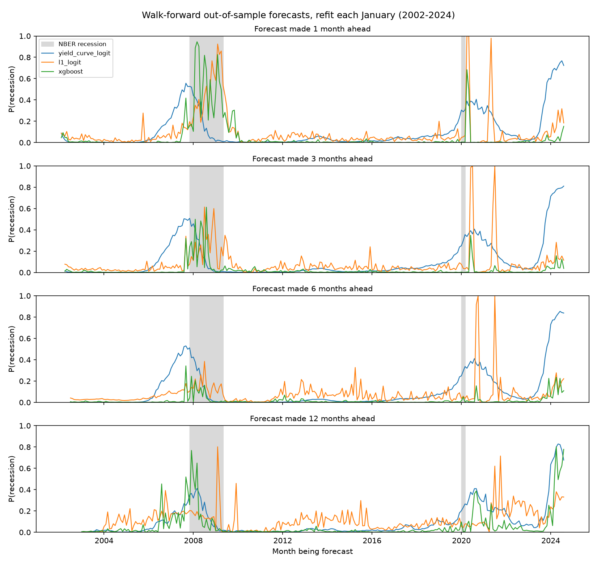
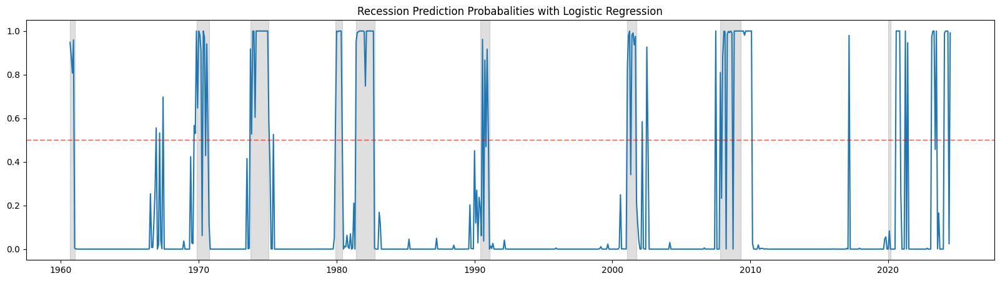
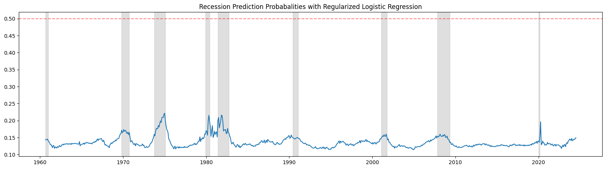
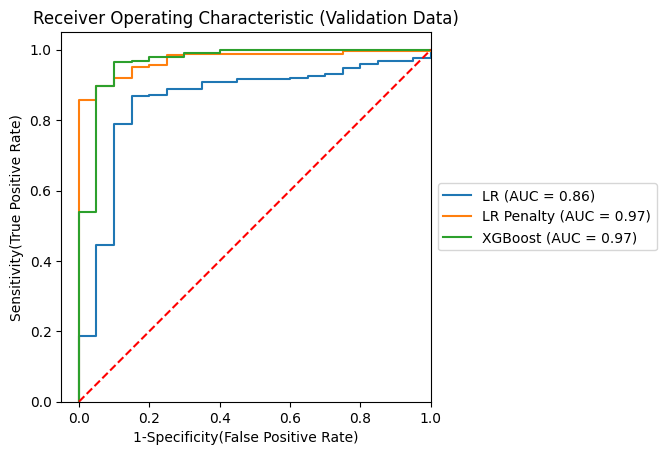
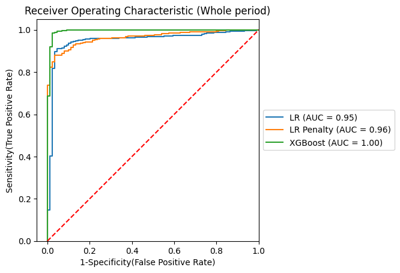

# Recession_Forecast

Forecasting US recessions (NBER) 1 to 12 months ahead from 129 FRED-MD macroeconomic series with regularized logistic regression and XGBoost.

## Leak-free, multi-horizon evaluation (update)

The original notebooks fit the stationarity tests, the scaler and the L1 feature selection on the **whole 1959–2024 sample** before splitting into training (1960–2001) and validation (2002–2024), and only forecast one month ahead. This update rebuilds the evaluation so nothing is learned from data after the forecast date, measures how much the leakage mattered, and forecasts 1, 3, 6 and 12 months ahead.

**What changed** (`recession/`, `run_evaluation.py`):
- Stationarity (ADF) decisions use the training window only.
- Scaling and L1 feature selection are steps inside a scikit-learn `Pipeline`, so they are re-fit on the training data of every CV fold and refit.
- Hyperparameters are chosen by `TimeSeriesSplit` CV inside the training window.
- **Walk-forward evaluation:** refit every January (2002–2024) and forecast that year.
- **Horizon-aware training cutoff:** at an h-month horizon, a training row's label is the regime h months later, so each refit only trains on rows whose outcome had already happened by the forecast date.
- **Benchmark:** logistic regression on the 10-year minus 3-month Treasury spread (the classic yield-curve recession signal).
- `tests/test_no_leakage.py` checks that features for month *t* ignore later data, that differencing decisions ignore post-training data, and that training never uses an unobserved label. All seeds are fixed; runs are reproducible.

**Walk-forward results, 2002–2024** (about 265 forecasts per horizon; 20 recession months, from 2 recessions):

| Horizon | Yield-curve logit AUC | L1 logit AUC | XGBoost AUC |
|---|---|---|---|
| 1 month | 0.71 | **0.95** | 0.95 |
| 3 months | 0.66 | **0.86** | 0.82 |
| 6 months | 0.63 | **0.85** | 0.72 |
| 12 months | **0.77** | 0.63 | 0.74 |

Average precision, Brier scores and single-split results are in `results/metrics.json`.

**Effect of the leakage** (1-month horizon, single split, same years): the original protocol gives AUC 0.93 (L1 logit) and 0.96 (XGBoost); the leak-free version gives 0.97 and 0.95. The leakage barely mattered here. The "XGBoost AUC 1.0" printed in `Forecasting.ipynb` was a bug: it printed a stale `auc` variable from an earlier cell.

**What I learned**
- **Short horizons are mostly nowcasting.** Recessions last many months, so "next month's regime" is largely "is the economy in a recession now". The ML models jump once a recession has started.
- **Skill decays with horizon, and at 12 months the 129-series models no longer beat the yield curve.** The yield curve rises one to two years ahead of 2008 and 2020, but it also false-alarmed in 2023–24.
- **Small sample:** the test period holds only two recessions, one of them the COVID shock, so differences of a few AUC points are noise. AUC (threshold-free ranking quality) is reported alongside average precision and Brier score because accuracy is misleading when 93% of months are not recessions.
- **Remaining caveats:** FRED-MD is a revised (not real-time) vintage, and NBER announces recession dates months after the fact, so a real-time system would know less than these backtests assume.

**Reproduce:** `uv sync && uv run pytest && uv run python run_evaluation.py`

---

## Original analysis

### Dataset: 
[Macroeconomic dataset](https://research.stlouisfed.org/econ/mccracken/fred-databases/) from FRED St. Louis desiged by McCracken and Ng. It involves 129 macroeconomic monthly time series data from 1959 to 2024.
8 Categories: Output and income, labor maket, housing, consumption, orders and inventories, money and credit, interest and exchange rate, prices in the stock market.

### NBER Recession Dates:
• Labelling based on NBER dataset
• 8 recession periods during the time period in consideration
• 693 'normal' periods and 95 recession periods

### Data Cleaning:
• Removal of variables with missing observation/ imputation of some sort
• Add lags of all variables as additional features
• Test stationarity of the time series
• Standardize the dataset

### Add lags of the variables as additional features:
• Add 3, 6, 9, 12, 18 month lags for each variable
• Shift labels for 1 month ahead prediction
• 769 observation points and 620 features

### Stationarity:
• Augmented Dickey Fuller Test. Null hypothesis of ADFis that the time series is non stationary with the alternative that it is stationary
• If p value > significance level, we cannot reject null hypothesis. Then take first order difference

### Standardization:
• Standardization of feature vectors by removing mean and scaling to unit variance

### Methodology:
• Perform feature selection to get the most important variables for the forecasts
• Separate dataset into training and validation datasets. 1960 - 2002: Training, 2002 - 2024: Validation
• Evaluate the performance of ML Algos on training set with Cross Validation
• Select the best performing models based on average accuracy and std dev of the CV results. Logistic Regression chosen as benchmark
• Make predictions on the validation dataset with selection models. Use GridSearchCV to find the best combination of hyperparameters. Evaluate the validation modela nd report accuracy metrics.

### Cross Validation:
• K Fold CV used:
	○ Train the model on (k-1) folds of the training data
	○ The resulting model is validated on the remaining part of the data
• 'TimeSeriesSplit' is CV technique for time series data. Use first k sets as training, (k+1) as test set

### Evaluation Metric: 
* ROC AUC Score

### Results: 

Result for standard logistic regression as the benchmark:

Result for $L_1$ regularized logistic regression: 

Result for XGBoost: 

ROC on validation data: 

ROC on all data (whole period): 

